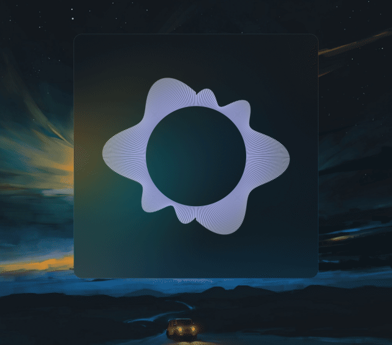
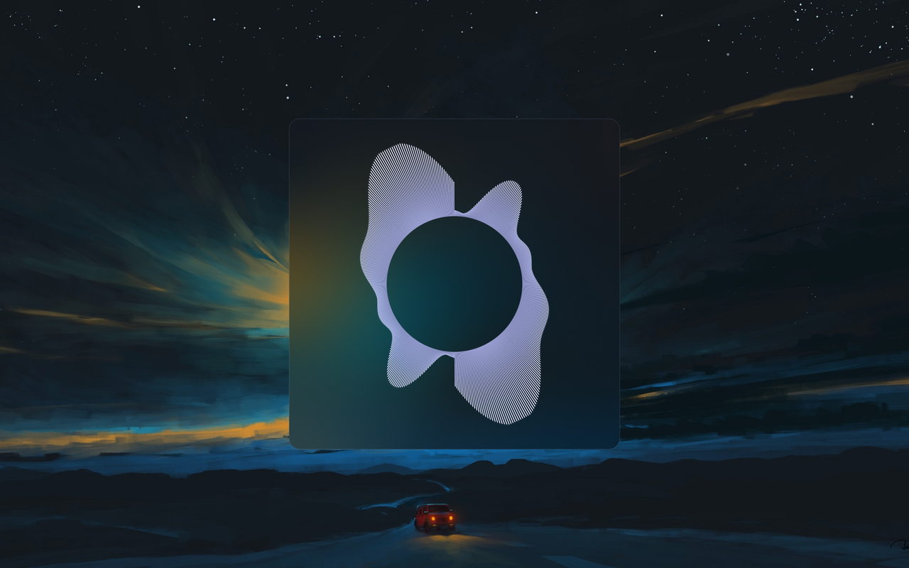
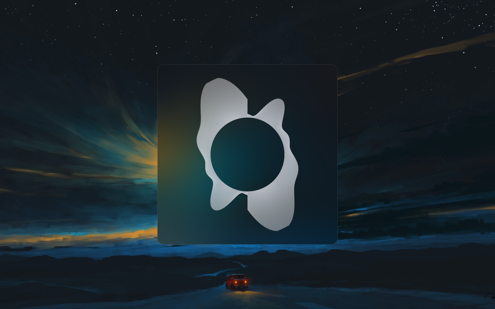

# Vizdial

A frosted, 120 FPS OpenGL radial audio visualizer with a 5-zone logarithmic dual-window FFTW3F engine and PipeWire/PulseAudio monitor capture.

<p align="center">
  
</p>

## Screenshots

<table>
  <tr>
    <td align="center">
      <br />
      <sub><b>Auto Theme</b> (KDE Accent / Matugen + KWin frosted blur)</sub>
    </td>
    <td align="center">
      <br />
      <sub><b>Monochrome</b> (<code>--monochrome</code> / key <code>C</code>)</sub>
    </td>
  </tr>
</table>

## Highlights

- **Symmetric 180-deg Wing Layout:** Left wing maps bass-up to treble-down (`12 -> 6` o'clock); right wing is mirrored and rotated 180 deg (`6 -> 12` o'clock) to form a balanced closed ring with no pulsing inner radius.
- **Dual-Window FFTW3F DSP (`20 Hz - 20 kHz`):** Combines an 8192-sample window (zero-padded to 32768 bins with sub-bin PSD interpolation) for tight sub-bass separation and a 2048-sample high-frequency window for crisp transients.
- **5 Configurable Frequency Zones:** Independently tune ray shares, frequency bounds, per-zone gain, local vs global AGC loudness tracking (`influence`), and per-zone sensitivity with calm deadzone damping.
- **360-deg Cyclic Blending:** Smooth parameter feathering and a 5-tap closed-ring seam filter across both internal zone boundaries and the 12 / 6 o'clock center seams.
- **Live Controls & Hot Reload:** Adjust height, gain, sensitivity, decay, and ray count live; save to `$XDG_CONFIG_HOME/vizdial/config.ini` (`~/.config/vizdial/config.ini`), or edit the config/shader directly with instant hot-reload.
- **Native KDE Wayland Frosted Blur:** Uses `KF6WindowSystem` rounded blur regions and isolates Qt styling via `Fusion` so third-party widget themes (`Kvantum` / `Darkly`) never overwrite rounded blur corners.

## Dependencies

**Arch Linux:**

```bash
sudo pacman -S --needed cmake pkgconf qt6-base qt6-wayland kwindowsystem fftw libpulse libglvnd hicolor-icon-theme
```

`kwindowsystem` is optional at compile time (`cmake` detects it automatically); without it, Vizdial builds and runs normally with translucent card rendering and no KWin blur protocol calls.

## Build & Install

```bash
cmake -B build -DCMAKE_BUILD_TYPE=Release
cmake --build build -j"$(nproc)"
```

Run directly from `build/` (the shader and default config are compiled in as resources):

```bash
./build/vizdial --demo
```

Or install system-wide:

```bash
sudo cmake --install build
```

For Arch packaging, see `packaging/arch/PKGBUILD`.

## Usage & CLI Flags

```bash
vizdial                 # live PipeWire/PulseAudio monitor (@DEFAULT_MONITOR@)
vizdial --demo          # synthetic demo spectrum
vizdial --zones         # print active 5-zone ray allocation & DSP settings
vizdial --bars 224      # rays per wing (full circle = 2 * N, up to 256)
vizdial --stereo        # stereo L/R wings instead of mono exact mirror
vizdial --monochrome    # silver-white monochrome palette
vizdial --ee            # capture easyeffects_sink.monitor
vizdial -f              # start fullscreen
```

## Live Keyboard & Mouse Controls

| Input | Action |
|---|---|
| `Drag` / `Double-click` | Move frameless window / Toggle fullscreen (`F`, `F11`) |
| `Up` / `Down`, `+` / `-`, `Scroll` | Adjust radial bar height (`max_length`) |
| `1` - `5` / `0` | Select Zone 1-5 / Deselect (all zones) |
| `Shift` + `Up` / `Down` | Adjust selected zone gain (or global gain) |
| `Shift` + `Left` / `Right` | Adjust selected zone sensitivity (or global sensitivity) |
| `,` / `.` | Decrease / increase selected zone local volume tracking (`influence`) |
| `Left` / `Right` | Decrease / increase ray count (`24` - `256` per wing) |
| `[` / `]` | Decrease / increase release decay (`ms`) |
| `M` / `C` / `Z` | Toggle `exact`/`stereo` · Toggle `auto`/`monochrome` · Show zone summary |
| `S` / `R` | Save current tweaks to `config.ini` / Force reload config & shader |
| `Esc` / `Q` | Quit |

## Configuration & Customization

On first launch, Vizdial writes a commented configuration to `~/.config/vizdial/config.ini`.

- **Custom fragment shader:** Copy `shaders/radial.frag` to `~/.config/vizdial/radial.frag` to edit GLSL live with automatic hot-reload.
- **Auto colors (`mode = auto`):** Reads `~/.config/kdeglobals` (`Colors:Complementary`, `AccentColor`) and optional `~/.config/cava/themes/matugen`, falling back cleanly to the built-in dark indigo glass palette on any desktop/compositor.
- **Non-KDE compositors (Hyprland/Sway/Picom):** Vizdial leaves window corners transparent with an anti-aliased SDF rim (`corner_radius` in px); enable compositor window blur rules on class `vizdial` if desired, or raise `bg_opacity`.

## License

GNU General Public License v3.0 or later — see [LICENSE](LICENSE).
